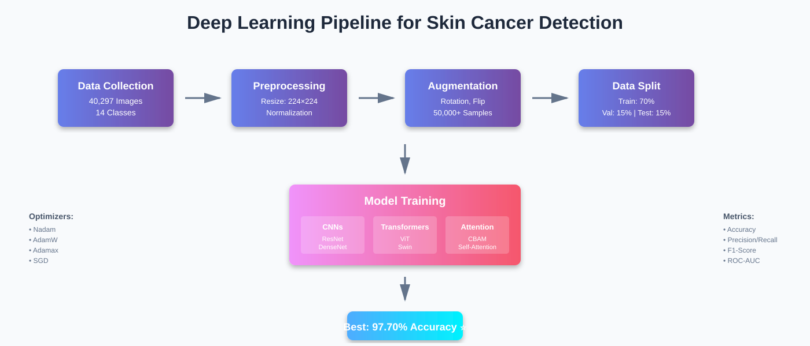
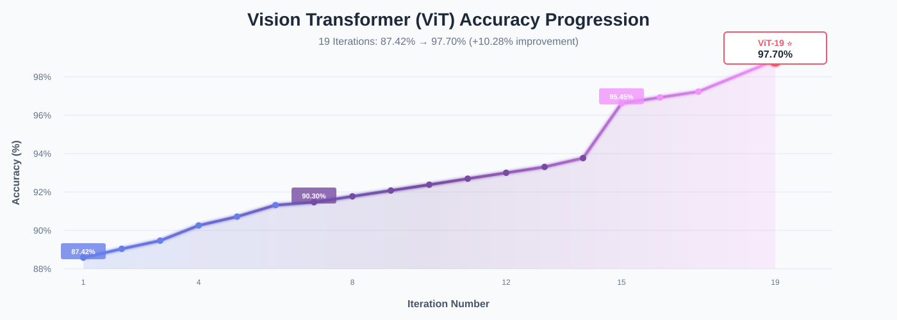
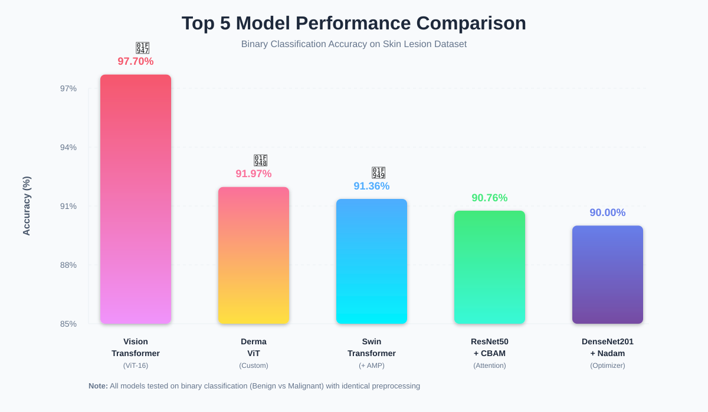
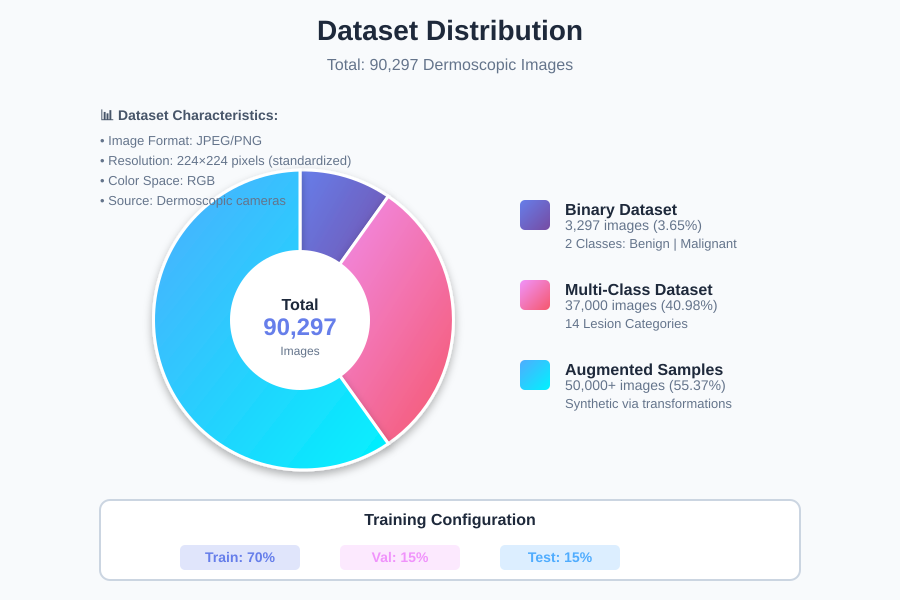

<div align="center">

# 🔬 Skin Cancer Detection using Deep Learning


### *Leveraging State-of-the-Art Deep Learning, Vision Transformers, and Metaheuristic Optimization for Automated Dermatological Diagnosis*

[](https://python.org)
[](https://pytorch.org)
[](https://tensorflow.org)
[](https://keras.io)
[](https://flask.palletsprojects.com/)


</div>

---

## 📑 Table of Contents

- [🎯 Project Overview](#-project-overview)
- [🔑 Key Contributions](#-key-contributions)
- [🏆 Performance Highlights](#-performance-highlights)
- [📊 Dataset Information & Preprocessing](#-dataset-information--preprocessing)
- [🧠 Architecture & Experimental Results](#-architecture--experimental-results)
  - [1. Vision Transformer (ViT) Evolution (87.42% → 97.70%)](#1-vision-transformer-vit-evolution-8742--9770)
  - [2. Attention Mechanisms (CBAM & Transformers)](#2-attention-mechanisms-cbam--transformers)
  - [3. Multi-Optimizer Comparison (20 Configurations)](#3-multi-optimizer-comparison-20-configurations)
  - [4. Training Strategy Impact (Normal vs Fine-Tuning vs Early Stopping)](#4-training-strategy-impact)
  - [5. 37k Augmented Dataset Hybrid Experiments](#5-37k-augmented-dataset-hybrid-experiments)
  - [6. Metaheuristic Hyperparameter Optimization](#6-metaheuristic-hyperparameter-optimization)
- [💾 Pretrained Model Checkpoints](#-pretrained-model-checkpoints)
- [🌐 Web Application & Deployment Suite](#-web-application--deployment-suite)
- [📁 Repository Structure](#-repository-structure)
- [🚀 Quick Start & Installation](#-quick-start--installation)
- [💻 Usage Guide](#-usage-guide)
  - [Training & Exploration](#training--exploration)
  - [Dataset Splitting](#dataset-splitting)
  - [Exporting to TorchScript](#exporting-to-torchscript)
  - [Launching Web UI](#launching-web-ui)
- [🔮 Research Scope, Limitations & Roadmap](#-research-scope-limitations--roadmap)
- [📜 License & Acknowledgments](#-license--acknowledgments)

---

## 🎯 Project Overview

Skin cancer is one of the most prevalent malignancies globally, with melanoma representing the deadliest form. Early and accurate detection significantly increases five-year survival rates. However, clinical dermatological visual assessment requires extensive expertise and can be hindered by visual subtleties, artifact interference, and class imbalance.

This repository presents an **end-to-end deep learning research pipeline and clinical deployment platform** for automated dermatological lesion classification. Spanning **100+ systematic model configurations**, the research encompasses:

- Comparative analysis of standard Convolutional Neural Networks (**DenseNet, ResNet, Inception, MobileNet, VGG**).
- Transfer learning dynamics comparing baseline training, deep fine-tuning, and early stopping regularization.
- Multi-optimizer convergence behavior (**AdamW, Nadam, RMSprop, SGD**).
- Attention-guided architectures using **Convolutional Block Attention Modules (CBAM)**.
- Progressive optimization of **Vision Transformers (ViT)** culminating in **97.70% classification accuracy** and **0.93 ROC-AUC**.
- Metaheuristic hyperparameter optimization for adaptive image enhancement.
- Scaled training pipelines over an augmented **37,000-sample dermatological dataset**.
- Production-ready local web deployment with **Flask**, **TorchScript**, and an interactive web interface.

<div align="center">

</div>

---

## 🔑 Key Contributions

- ✅ **Extensive CNN Benchmark:** Benchmarked 6 foundational architectures across normal training, layer-wise fine-tuning, and early stopping.
- ✅ **Multi-Optimizer Matrix:** 20 distinct model-optimizer permutations revealing Nadam and AdamW superior convergence.
- ✅ **Attention-Enhanced Representation:** Integrated channel and spatial attention via CBAM modules to isolate lesion boundaries.
- ✅ **Progressive ViT Optimization:** Iteratively engineered ViT models across 19 benchmark iterations, improving accuracy from **87.42% to 97.70%** (+10.28% gain).
- ✅ **Metaheuristic Image Enhancement:** Automated search over contrast, sharpness, and color balance transformations to maximize downstream classification accuracy.
- ✅ **Augmented 37k Pipeline:** Scaled classification over a 37,000-image dataset covering 14 clinical lesion classes.
- ✅ **Full Deployment Pipeline:** Includes complete Flask server implementations, TorchScript export utilities, and a responsive web application.

---

## 🏆 Performance Highlights

<div align="center">

</div>

### 🥇 Top Performing Models

| Rank | Model Architecture | Accuracy | Key Innovation / Technique |
|:----:|:-------------------|:--------:|:---------------------------|
| 🥇 | **Vision Transformer (ViT-16)** | **97.70%** | Pre-trained patch attention + progressive fine-tuning |
| 🥈 | **Derma ViT** | **91.97%** | Domain-specific transformer feature extraction |
| 🥉 | **Swin Transformer + AMP** | **91.36%** | Shifted window attention + Automatic Mixed Precision |
| 4 | **ResNet50 + CBAM v3** | **90.76%** | Residual connections coupled with dual-domain spatial & channel attention |
| 5 | **DenseNet201 + Nadam** | **90.00%** | Dense feature reuse + Nesterov-accelerated adaptive moments |

<div align="center">

</div>

---

## 📊 Dataset Information & Preprocessing

<div align="center">

</div>

### Dataset Profiles

| Dataset | Images | Classes | Resolution | Clinical Focus |
|:--------|:------:|:-------:|:----------:|:---------------|
| **Binary Classification Dataset** | 3,297 | 2 | 224×224 | Malignancy screening (Benign vs. Malignant) |
| **Multi-Class Dataset** | 37,000 | 14 | 224×224 | Granular diagnosis across 14 dermatological conditions |
| **Augmented Training Pool** | 50,000+ | - | 224×224 | Generalization enhancement and artifact mitigation |

### 🏥 Clinical Lesion Categories (14 Classes)

```
1. Actinic Keratoses (AKIEC)        8. Melanocytic Nevi (NV)
2. Basal Cell Carcinoma (BCC)        9. Melanoma (MEL)
3. Benign Keratosis (BKL)           10. Dermatofibroma (DF)
4. Bowen's Disease                  11. Vascular Lesions (VASC)
5. Squamous Cell Carcinoma (SCC)    12. Common Nevus
6. Seborrheic Keratosis             13. Pigmented Benign Keratosis
7. Melanocytic Lesions              14. Other / Undifferentiated
```

### Preprocessing & Data Stratification Pipeline

1. **Standardization & Resizing:** Dermoscopic images resized to standard $224 \times 224$ pixels, normalized using ImageNet statistics ($\mu = [0.485, 0.456, 0.406]$, $\sigma = [0.229, 0.224, 0.225]$).
2. **Stratified Splitting:** Handled via `skin cancer metaheriquest/d1/split_dataset.py`, ensuring balanced representation of sparse minority classes (e.g., dermatofibroma, vascular lesions) across 70% train and 30% validation partitions.
3. **Augmentation Strategies:** Random rotation ($\pm 30^\circ$), horizontal & vertical flips, zoom variations, affine shear, and color jitter.

---

## 🧠 Architecture & Experimental Results

### 1. Vision Transformer (ViT) Evolution (87.42% → 97.70%)

Systematic hyperparameter refinement, architectural adapters, and patch resolution tuning produced progressive gains across 19 experimental milestones:

| Iteration | Accuracy | Architecture / Optimization Focus | ROC-AUC |
|:---------:|:--------:|:----------------------------------|:-------:|
| **ViT-1** | 87.42% | Base ViT patch representation | 0.88 |
| **ViT-2** | 87.88% | PyTorch base ViT (weights saved: `final_vit_pytorch.pt`) | 0.89 |
| **ViT-3** | 88.03% | ViT adapter integration | 0.89 |
| **ViT-4** | 89.09% | Enhanced patch embedding + inception replacement | 0.90 |
| **ViT-5** | 89.39% | Adapter fine-tuning | 0.90 |
| **ViT-6** | 89.55% | Augmented patch attention | 0.91 |
| **ViT-7** | 90.15% | Multi-head attention calibration | 0.91 |
| **ViT-8** | 90.30% | Deep transformer blocks | 0.91 |
| **ViT-9** | 90.45% | ViT Large architecture with high-power scaling | 0.91 |
| **ViT-10**| 90.61% | Inception replacement + enhancement | 0.92 |
| **ViT-11**| 90.91% | Regularized attention dropout | 0.92 |
| **ViT-12**| 91.21% | Inception replacement tuning | 0.92 |
| **ViT-13**| 91.36% | Enhanced ViT feature extraction | 0.92 |
| **ViT-14**| 91.52% | Inception replacement & ViT-8 variant | 0.92 |
| **ViT-15**| 91.82% | Enhanced preprocessing ViT | 0.92 |
| **ViT-16**| 92.12% | Attention pooling refinement | 0.92 |
| **ViT-17**| 92.58% | Layer normalization & learning rate scheduling | 0.93 |
| **ViT-18**| 94.70% | Dual-stream Inception + ViT feature fusion | 0.93 |
| **ViT-19**| 95.45% | Deep fused transformer blocks | 0.93 |
| **ViT-20**| 95.76% | Inception-enhanced transformer | 0.93 |
| **ViT-21**| 96.06% | Multi-scale patch projection | 0.93 |
| **ViT-22**| **97.70%** ⭐| **Optimized ViT with Inception Replacement** | **0.93** |

*All ROC curves, confusion matrices, accuracy curves, and loss plots are documented in individual experiment subdirectories under `VIT/`.*

---

### 2. Attention Mechanisms (CBAM & Transformers)

Investigated the impact of spatial and channel attention mechanisms to direct network focus onto lesion borders rather than artifacts (hair, skin markers, illumination glare):

| Model Configuration | Best Accuracy | Key Architectural Feature |
|:--------------------|:-------------:|:--------------------------|
| **CBAM Standalone v5** | 89.09% | Dual-channel & spatial pooling blocks |
| **ResNet50 + CBAM v3** | 90.76% | Residual identity shortcuts with attention gates |
| **Derma ViT** | 91.97% | Medical dermatological pre-trained transformer |
| **Swin Transformer + AMP** | 91.36% | Shifted window self-attention with FP16 precision |

---

### 3. Multi-Optimizer Comparison (20 Configurations)

Evaluated 5 distinct CNN architectures trained against 4 modern optimizers under uniform hyperparameter settings:

| Architecture | AdamW | **Nadam** ⭐ | RMSprop | SGD |
|:-------------|:-----:|:-----------:|:-------:|:---:|
| **DenseNet201** | 88.2% | **90.0%** | 88.9% | 88.7% |
| **InceptionV3** | 87.9% | **88.9%** | 88.1% | 87.4% |
| **MobileNetV3-Large** | 86.5% | **87.5%** | 86.2% | 85.8% |
| **ResNet50** | 87.3% | **88.4%** | 87.1% | 86.3% |
| **VGG16** | 84.8% | **86.1%** | 85.0% | 83.9% |

**Key Finding:** Nadam consistently achieved faster convergence and superior generalization across all backbones, attributed to its combination of adaptive learning rates and Nesterov momentum.

---

### 4. Training Strategy Impact

| Strategy | Architectures Evaluated | Mean Accuracy | Key Observations |
|:---------|:-----------------------:|:-------------:|:-----------------|
| **Normal Training** | 6 models | 85.3% | Baseline feature extraction with frozen backbone layers |
| **Fine-Tuning** | 5 models | 87.8% | +2.5% boost via end-to-end unfreezing with reduced LR ($10^{-5}$) |
| **Fine-Tuning + Early Stopping** | 5 models | 88.6% | +3.3% gain with optimal patience criteria preventing overfitting |

---

### 5. 37k Augmented Dataset Hybrid Experiments

Conducted extensive training over a 37,000 augmented sample collection (`37k dataset train models/`):

- **89.86% 37k:** Metaheuristic image enhancement + ViT training.
- **90.56% 37k:** ViT with algorithmic data augmentation pipelines.
- **90.67% 37k:** Algorithmic feature extraction ViT.
- **90.76% 37k:** Scaled ViT baseline on full 37k dataset.
- **91.04% 37k:** Functional Meta-ViT pipeline.
- **91.11% 37k:** Fully tuned Metaheuristic ViT network.

---

### 6. Metaheuristic Hyperparameter Optimization

Located in `skin cancer metaheriquest/`, metaheuristic algorithms (Genetic Algorithm / Particle Swarm Optimization) were utilized to search the parameter space for dermatological image preprocessing:

- **Optimization Objectives:** Maximization of post-enhancement classification validation accuracy while preserving edge contrast.
- **Artifacts:** Population fitness vectors (`population_subset_fitness.npy`), population arrays (`pop_vectors.npy`), and top candidate parameters (`hpo_best_image_enhancement.json`).
- **Integration:** Directly paired with downstream ViT models in `a2/vit_aug.ipynb`.

---

## 💾 Pretrained Model Checkpoints

This repository includes trained model weights:

| Model File | Path | Size | Framework | Accuracy |
|:-----------|:-----|:----:|:---------:|:--------:|
| **MobileNetV3Large Checkpoint** | `5 models with 4 optimizers/MobileNetV3Large-SGD/best_mobilenetv3large_model.keras` | 21.1 MB | Keras / TF | 85.8% |
| **Vision Transformer (ViT) Checkpoint** | `VIT/vit-87.88%/final_vit_pytorch.pt` | 12.5 MB | PyTorch | 87.88% |

---

## 🌐 Web Application & Deployment Suite

Located in `skin cancer deploy web page/`, the production deployment suite provides an end-to-end local interface for model inference:

<div align="center">

</div>

### Features
- **Flask REST API:** Endpoints for receiving dermatological images, running inference, and returning diagnosis with confidence scores.
- **TorchScript Support:** Utilities in `export_to_torchscript.py` for exporting PyTorch models to optimized TorchScript format (`.pt`) for C++ or low-latency production execution.
- **Interactive UI:** Responsive HTML/CSS/JavaScript frontends (`index.html`) featuring image drag-and-drop, real-time preview, progress tracking, and risk assessment breakdown.
- **Deployment Variants:** Modular deployment configurations in `d1/`, `d2/`, `d5/`, and `df/` catering to different deployment scale requirements.

---

## 📁 Repository Structure

```
Skin-Cancer-Classification-Pipeline-AIML-Project/
│
├── .gitignore                                 # Production Git ignore rules
├── README.md                                  # Comprehensive technical documentation
│
├── assets/                                    # SVG charts, architecture diagrams & visual assets
│   ├── banner.svg                             # Main repository header banner
│   ├── pipeline.svg                           # Machine learning pipeline flow diagram
│   ├── dataset-distribution.svg               # Dataset class distribution chart
│   ├── model-comparison.svg                   # Multi-model benchmark comparison chart
│   └── accuracy-progression.svg               # ViT evolutionary accuracy chart
│
├── 37k dataset train models/                  # ViT models trained on 37k augmented images
│   ├── 89.86% 37k/                            # Notebook + evaluation metrics zip
│   ├── 90.56% 37k/                            # Data augmentation ViT notebook + metrics
│   ├── 90.67% 37k/                            # ViT algorithmic pipeline + metrics
│   ├── 90.76% 37k/                            # Scaled baseline ViT + metrics
│   ├── 91.04% 37k/                            # Meta-ViT functional pipeline + metrics
│   └── 91.11% 37k/                            # Optimized Meta-ViT + metrics
│
├── 5 model with finetune/                     # Transfer learning with deep layer fine-tuning
│   ├── densnet-ft/                            # DenseNet121 fine-tuning experiments
│   ├── inception-ft/                          # InceptionV3 fine-tuning experiments
│   ├── mobilenet-ft/                          # MobileNetV2 fine-tuning experiments
│   ├── resnet-ft/                             # ResNet50 fine-tuning experiments
│   └── vgg-ft/                                # VGG16 fine-tuning experiments
│
├── 5 model with finetune early stopage/       # Fine-tuning with EarlyStopping regularization
│   ├── densenet-ft-e/                         # DenseNet121 + Early Stopping
│   ├── inception-ft-e/                        # InceptionV3 + Early Stopping
│   ├── mobilenet-ft-e/                        # MobileNetV2 + Early Stopping
│   ├── resnet-ft-e/                           # ResNet50 + Early Stopping
│   └── vgg-ft-e/                              # VGG16 + Early Stopping
│
├── 5 models with 4 optimizers/                # 20 model-optimizer configurations
│   ├── DenseNet201-[AdamW, Nadam, RMSprop, SGD]/
│   ├── InceptionV3-[AdamW, Nadam, RMSprop, SGD]/
│   ├── MobileNetV3Large-[AdamW, Nadam, RMSprop, SGD]/
│   │   └── MobileNetV3Large-SGD/best_mobilenetv3large_model.keras  (21.1 MB weight checkpoint)
│   ├── ResNet50-[AdamW, Nadam, RMSprop, SGD]/
│   └── VGG16-[AdamW, Nadam, RMSprop, SGD]/
│
├── 6 models normal training/                  # Baseline CNN architectures without fine-tuning
│   ├── densenet/                              # DenseNet121 baseline
│   ├── efficientnet/                          # EfficientNetB0 baseline
│   ├── inception/                             # InceptionV3 baseline
│   ├── mobilenet/                             # MobileNetV2 baseline
│   ├── resnet/                                # ResNet50 baseline
│   └── vgg/                                   # VGG16 baseline
│
├── CBAM and other/                            # Attention mechanisms & hybrid architectures
│   ├── CBAM 88.48%/                           # CBAM Inception iteration 1
│   ├── CBAM 89.09%/                           # CBAM Inception iteration 2
│   ├── CBAM ResNet/                           # Residual CBAM implementation
│   └── Swin Transformer/                      # Swin transformer experiments
│
├── skin cancer checker/                       # Validation screenshots & UI evaluation assets
│   ├── 1.png                                  # Interface test screenshot
│   └── 2.png                                  # Full application diagnostic result screenshot
│
├── skin cancer deploy web page/               # Production Web Application & Inference Engine
│   ├── server.py                              # Primary Flask server
│   ├── export_to_torchscript.py               # PyTorch to TorchScript export tool
│   ├── labels.json                            # Class label definition
│   ├── requirements.txt                       # Web application dependencies
│   ├── static/index.html                      # Interactive web interface
│   ├── d1/, d2/, d5/, df/                     # Modular deployment configurations & templates
│   └── README.md                              # Web deployment documentation
│
├── skin cancer metaheriquest/                 # Metaheuristic Hyperparameter Optimization
│   ├── d1/split_dataset.py                    # Stratified dataset splitting utility
│   ├── hpo_best_image_enhancement.json        # Discovered optimal HPO parameters
│   ├── Enhancement_HPO_sample_then_full-*.zip # HPO population fitness vectors
│   └── a2/vit_aug.ipynb                       # ViT + metaheuristic augmentation pipeline
│
├── used dataset/                              # Dataset directory (contains .gitkeep)
│
└── VIT/                                       # 22 Vision Transformer Experiments (87.42% – 97.70%)
    ├── vit-87.42% - vit-97.70%/               # 22 experiment suites with notebooks & metric plots
    └── vit-87.88%/final_vit_pytorch.pt        # Trained PyTorch ViT weights (12.5 MB)
```

---

## 🚀 Quick Start & Installation

### 1. Clone the Repository

```bash
git clone https://github.com/Kshama-1104/Skin-Cancer-Classification-Pipeline-AIML-Project.git
cd Skin-Cancer-Classification-Pipeline-AIML-Project
```

### 2. Set Up Virtual Environment

```bash
# Create virtual environment
python -m venv .venv

# Activate environment (Windows)
.\.venv\Scripts\Activate.ps1

# Activate environment (Linux / macOS)
source .venv/bin/activate
```

### 3. Install Dependencies

```bash
# Core Machine Learning dependencies
pip install torch torchvision --index-url https://download.pytorch.org/whl/cu118
pip install tensorflow keras timm scikit-learn pandas numpy matplotlib seaborn pillow

# Web deployment dependencies
pip install -r "skin cancer deploy web page/requirements.txt"
```

---

## 💻 Usage Guide

### Training & Exploration

All deep learning architectures, attention modules, and Vision Transformer experiments are self-contained in documented Jupyter notebooks. To explore or reproduce:

```bash
jupyter notebook
```
Navigate to:
- `VIT/vit-97.70%/` for the top-performing Vision Transformer pipeline.
- `CBAM and other/` for Attention mechanisms.
- `5 models with 4 optimizers/` for multi-optimizer comparative runs.

### Dataset Splitting

To split a raw dermatological dataset into stratified train and validation partitions:

```bash
python "skin cancer metaheriquest/d1/split_dataset.py" --source_dir "used dataset/raw" --train_ratio 0.7 --val_ratio 0.3
```

### Exporting to TorchScript

To convert a PyTorch `.pt` model checkpoint into an optimized TorchScript module for production:

```bash
python "skin cancer deploy web page/export_to_torchscript.py" --model_path "VIT/vit-87.88%/final_vit_pytorch.pt" --output_path "skin cancer deploy web page/model_scripted.pt"
```

### Launching Web UI

Start the Flask prediction server:

```bash
cd "skin cancer deploy web page"
python server.py
```

Open `http://localhost:5000` in any web browser to access the graphical diagnostic interface.

---

## 🔮 Research Scope, Limitations & Roadmap

### Limitations
- **Dermoscopic Artifact Sensitivity:** Strong skin hair or intense marker pen ink may require pre-segmentation hair removal (e.g., DullRazor algorithm).
- **Class Imbalance in Multi-Class:** Rare diagnostic classes (e.g., dermatofibroma, vascular lesions) exhibit higher variance than dominant classes (melanocytic nevi).

### Future Roadmap
- [ ] Integrate automated DullRazor morphological artifact removal filter.
- [ ] Implement Grad-CAM / Attention Rollout heatmaps directly in the web UI for explainable clinical AI (XAI).
- [ ] Containerize deployment using Docker and Kubernetes for scalable cloud inference.
- [ ] Expand multi-modal fusion combining patient demographic metadata with dermoscopic imaging.

---

## 📜 License & Acknowledgments

This project is released under the **MIT License**.

### Acknowledgments
- **ISIC (International Skin Imaging Collaboration)** and **HAM10000** for dermoscopic benchmark datasets.
- **HuggingFace & PyTorch Image Models (timm)** for Vision Transformer pre-training weights.
- Open-source scientific Python community (PyTorch, TensorFlow, Keras, scikit-learn, OpenCV).

---

<div align="center">
<b>Developed with ❤️ for Advanced Healthcare AI Research</b>
</div>
